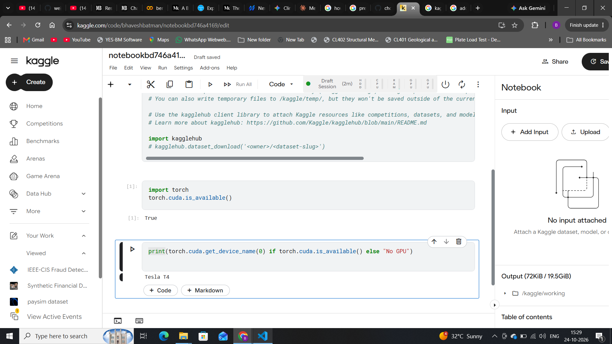

## Project Goal:
A platform where chest X-ray scans are uploaded,a classifier flags findings on chest X-rays, a segmentation model outlines structures in 3D scans, both with explanation heatmaps, reviewed by a radiologist

## Verified Environment:

    - OS = Windows11 + WSL2(Ubuntu)
    - Python = 3.14.4
    - GPU = None
    - RAM = 8GB
    - Project Disk (D:/) = 86.7 GB Free
    - RAM = 8 GB Total(WSL Visible: 3.8Gi  Swap: 4.0Gi)        
    - GPU = Not Available (Kaggle Tesla T4 for Training)
    

## Installation:

Execute the following commands inside your WSL terminal

 1. **Clone the Repository**:
 '''bash
 cd/mnt/d
 git clone https://github.com/gotham-saviour/medical_imaging_diagnosis.git
 cd medical_imaging_diagnosis
 '''

 2. **Set Up Virtual Environments**

'''bash
python3 -m venv .venv
source .venv/bin/activate
'''

3. **Installing the Dependencies**

'''bash
uv pip sync requirements.txt requirements-dev.txt
'''

## **NOTICE**: For Education only, not Clinical Use
