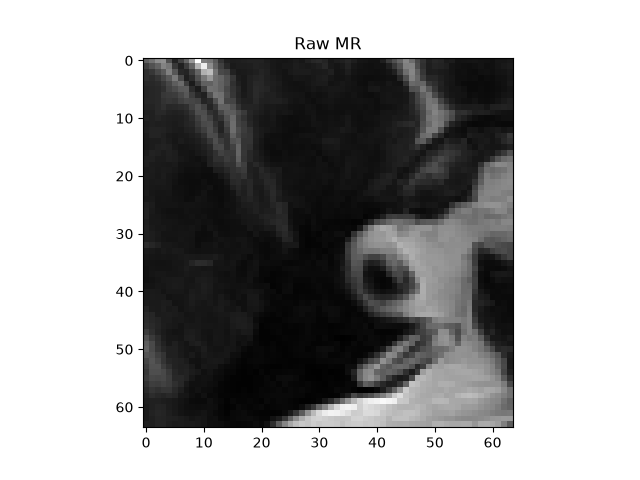
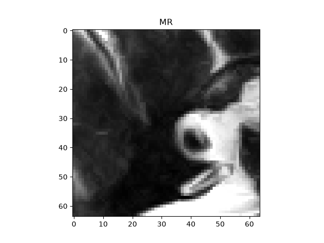

# Technical Note: DICOM Structure, Preprocessing, and De-Identification (`MR_small.dcm`)

| Raw Unwindowed Scan (`ds.pixel_array`) | Windowed & Normalized Scan (`uint8`) |
| ----- | ----- |
|  |  |

## 1. DICOM Information Hierarchy

The DICOM data model organizes clinical imaging into a strict four-level hierarchy (`Patient` $\rightarrow$ `Study` $\rightarrow$ `Series` $\rightarrow$ `Instance`). In `dicom_explore.py`, our run on `MR_small.dcm` extracted the following identifiers:

| Hierarchy Level | Tag Keyword | Value from Script Output | Python Type | What It Identifies |
| ----- | ----- | ----- | ----- | ----- |
| **Patient** | `PatientID` | `4MR1` | `str` | Uniquely identifies the individual subject . Used for leak-free `GroupShuffleSplit` partitioning so a patient's scans never span across `train`, `val`, and `test`. |
| **Study** | `StudyInstanceUID` | `1.3.6.1.4.1.5962.1.2.4.20040826185059.5457` | `UID` | Identifies a single imaging examination/order (which may include multiple pulse sequences or views taken during the same appointment). |
| **Series** | `SeriesInstanceUID` | `1.3.6.1.4.1.5962.1.3.4.1.20040826185059.5457` | `UID` | Identifies a specific acquisition run or 3D volumetric stack within a study (e.g., a single Spin Echo `SE` MRI sequence or CT reconstruction kernel). |
| **Instance** | `SOPInstanceUID` | `1.3.6.1.4.1.5962.1.1.4.1.1.20040826185059.5457` | `UID` | Globally unique identifier for this exact 2D slice or DICOM object (`SOP` = Service-Object Pair). |

## 2. Tags Used in Preprocessing & Missing-Tag Fallback Behavior

Our preprocessing pipeline inspects specific image-plane and intensity tags before converting pixels into model-ready tensors:

* **`Rows` (`64`, `int`) & `Columns` (`64`, `int`):** Define the pixel grid dimensions $(64 \times 64)$ of the slice. Required to validate tensor shapes and configure spatial resizing transforms.

* **`PixelSpacing` (`[0.3125, 0.3125]`, `MultiValue`):** Represents the physical distance in the patient between pixel centers, formatted as a two-value pair: [row spacing (vertical), column spacing (horizontal)] in mm.(**unverified**,until text review(PS 3.3) is completed) Essential in 3D segmentation (e.g., MONAI `Spacingd`) so models learn true anatomical sizes rather than scanner zoom factors.

* **`BitsAllocated` (`16`, `int`) & `BitsStored` (`16`, `int`):** Indicate how many bits are allocated per pixel in memory and how many actually store dynamic range. Because `MR_small.dcm` uses signed 16-bit integers (`PixelRepresentation = 1`), values can exceed `[0, 255]`, requiring explicit rescaling prior to 8-bit display.

* **`PhotometricInterpretation` (`MONOCHROME2`, `str`):** Dictates polarity. `MONOCHROME2` means minimum intensity is rendered black and maximum intensity is rendered white.If a scanner outputs `MONOCHROME1` (inverted), our preprocessing must invert the array so pathology features remain consistent.(**not implemented**, TODO in Sprint 1 )

* **`RescaleSlope` (`Attribute Not Available`) & `RescaleIntercept` (`Attribute Not Available`):** Convert arbitrary scanner storage values into physical units (such as Hounsfield Units in CT via $\text{HU} = \text{pixel} \times \text{RescaleSlope} + \text{RescaleIntercept}$).

  * **How Our Code Handles Missing Tags (`RescaleSlope` Example):** In this file `RescaleSlope` and `RescaleIntercept` are absent from the header (`print_tags` outputs `Attribute Not Available`). In `to_hounsfield_or_stored(ds)`, we use defensive attribute lookup with identity defaults:
    `rescale_slope = float(getattr(ds, "RescaleSlope", 1.0))` and `rescale_intercept = float(getattr(ds, "RescaleIntercept", 0.0))`. This safely preserves the stored MRI signal intensities as `float32` ($I \times 1.0 + 0.0$) without raising an `AttributeError`.

* **`WindowCenter` (`600.0`, `DSfloat`) & `WindowWidth` (`1600.0`, `DSfloat`):** Define the clinical intensity range of interest ($[600 - 800, 600 + 800] = [-200.0, 1400.0]$). If these tags are missing, `get_window()` falls back to full min-max intensity scaling across `scaled_pixels`.

## 3. Protected Health Information (PHI) & De-Identification Strategy

Before clinical DICOM studies leave a hospital PACS or enter a machine learning training bucket, Protected Health Information (PHI) must be sanitized in accordance with the **DICOM Standard De-Identification Profile (DICOM PS3.15 Annex E — Attribute Confidentiality Profiles)** *(reference cited; **unverified** until primary text review is completed)*.

Below is our de-identification plan for the 9 PHI tags inspected in `dicom_explore.py` (plus `PatientID`):

| Tag Name | Value in `MR_small.dcm` | Category | De-Identification Action |
| :--- | :--- | :--- | :--- |
| `PatientName` | `CompressedSamples^MR1` | Direct PHI | **Replace consistently** with a keyed pseudonymous hash (`PAT_8f3a...`) or dummy string. |
| `PatientID` | `4MR1` (`str`) | Direct PHI | **Replace consistently (keyed hash or stored mapping table)** | Must **never** be blanked or randomized per-file, otherwise longitudinal scans from the same patient cannot be grouped during `train`/`val`/`test` splitting. |
| `PatientBirthDate` | `[Empty String]` | Direct PHI | **Blank / Remove** (or coarsen to birth year if age is clinically required). |
| `InstitutionName` | `TOSHIBA` | Direct / Quasi-PHI | **Remove or Blank** to prevent site identification. |
| `ReferringPhysicianName` | `[Empty String]` | Direct PHI | **Blank / Remove**. |
| `AccessionNumber` | `[Empty String]` | Direct Identifier | **Replace consistently** via salted hash so multi-study links remain intact without exposing PACS IDs. |
| `StudyDate` / `StudyTime` | `20040826` / `185059` | Temporal Quasi-PHI | **Shift consistently** by a per-patient random day offset (preserving longitudinal intervals between scans) and blank/zero `StudyTime`. |
| `Manufacturer` | `TOSHIBA_MEC` | Indirect Identifier | **Retain or generalize** carefully (needed for scanner-bias auditing, though combined with serial/site tags it narrows origin). |
| `DeviceSerialNumber` | `-0000200` | Indirect Identifier | **Remove or Hash** — uniquely identifies a single physical scanner at a specific hospital. |
| `Study/Series/SOP UIDs` | `...20040826185059.5457` | Embedded Timestamp Leak | **Regenerate deterministically** (e.g., UUIDv5 / `2.25.<int>` mapped from a secret salt + original UID)(**unverified**,it is a design idea not a standard practice). Date-shifting `StudyDate` is useless if the UID still contains `20040826185059` (`StudyDate` + `StudyTime`). Consistent mapping keeps Study $\rightarrow$ Series $\rightarrow$ Instance links intact. |

* **Burned-In Pixel PHI Risk (Critical for Grad-CAM):** De-identifying metadata headers is not sufficient. Ultrasound, portable X-ray (`CR`/`DX`), and secondary capture scans frequently contain **burned-in text annotations** baked directly into `ds.pixel_array` (such as patient names, timestamps). Also need to check the **BurnedInAnnotation tag**, a DICOM standard attribute that indicates whether an image contains patient-identifying text or graphics rendered directly into the pixel data.(**unverified**)Aside from leaking PHI, our CNN can latch onto burned-in text or hospital markers as a spurious shortcut. In Sprint 4, we must inspect our **Grad-CAM** activation heatmaps to verify that the model focuses on the lung parenchyma rather than burned-in corner text.

## 4. Link Back to the Dataset Memo: 8-Bit Quantization & Geometry Risks

**Confirmation of the 8-Bit Dynamic Range Loss Risk:**
Our initial dataset memo warned that pre-converting 12-bit/16-bit medical scans into standard 8-bit PNG files (as done in public distributions of NIH ChestX-ray14) (**unverified**,TODO in Sprint 1) permanently crushes intensity resolution. Running our intensity counter on `MR_small.dcm` confirms this risk directly:

* **Distinct intensity values before windowing (`scaled_pixels`, `float32`):** **`1128` unique values**(**confirmed**) (spanning from `127.0` to `2145.0` across the $64 \times 64 = 4096$ pixels).

* **Distinct intensity values after 8-bit windowing (`windowed_image`, `uint8` with `WL=600, WW=1600`):** **`204` unique values**(**confirmed**) (spanning `0` to `255`, because values above the upper bound `1400.0` are clipped to `255`, values below `-200.0` are clipped to `0`, and intermediate intensities are quantized into integer bins).
  This proves the dataset memo's warning: casting to 8-bit `uint8` collapses **82% of the unique intensity levels** ($1128 \rightarrow 204$) in a single $64 \times 64$ slice. If the wrong window is applied before saving to PNG, subtle soft-tissue contrast or high-density pathology (>1400) are irrecoverably lost.(which in our dataset are 222 pixel values,**confirmed** )

  Also with no clipping applied 8-bit quantization gives `225` unique levels(**confirmed**), so almost all of the loss comes from 8-bit quantization itself not from the clipping window.

**The above values are calculated for this (64x64) sample, this percentage isn't the General Rate.**

**NIfTI-to-DICOM 3D Geometry Risk (*Still Unverified*):**
For our 3D segmentation dataset (Medical Segmentation Decathlon, distributed in NIfTI `.nii.gz` format), converting between 3D NIfTI volumes and 2D DICOM slice series carries a high risk of spatial coordinate mismatch (**still unverified** in our pipeline). Specifically, NIfTI uses a single $4 \times 4$ affine transformation matrix (often in `RAS+` orientation), whereas DICOM defines 3D geometry slice-by-slice using `ImagePositionPatient` `(0020,0032)`(`[-83.9063, -91.2, 6.6406]`,**confirmed**), `ImageOrientationPatient` `(0020,0037)`(`[1, 0, 0, 0, 1, 0]`,**confirmed**) (in `LPS+` coordinates), and `PixelSpacing`.
Until we write a round-trip geometry test in Sprint 3, any discrepancies in slice ordering, affine orientation (`LPS` vs. `RAS`), or oblique gantry tilt during NIfTI-to-DICOM conversion remain **still unverified**.

## 5. Claim Ledger

| Claim | Tag | Test |
| ----- | ----- | -----|
| Header Values, UIDs and Geometry Tags | **confirmed** |  test_print_tags
| Unique Pixel Count Raw Image: `1128` | **confirmed** | test_sample_intensity_report`(12.a)`
| Unique Pixel Count Windowed Image: `204` | **confirmed** | test_sample_intensity_report`(12.b)`
| Number of Pixels Clipped by Window Clipping: 222 | **confirmed** | test_sample_intensity_report`(12.c)`
| Unique Pixel Count No Clipping: 225 | **confirmed** | test_sample_intensity_report`(12.d)`
| Pixel Spacing order | **unverified** | -- |
| DICOM PS3.15 Annex E — Attribute Confidentiality Profiles | **unverified** | -- |
| NIH Images are 8 bit | **unverified** | -- |
| NIfTI to DICOM Geometry | **unverified** | -- |
| MONOCHROME1 Handling| **not implemented** | -- |
| BurnedInAnnotation | **unverified** | -- |
